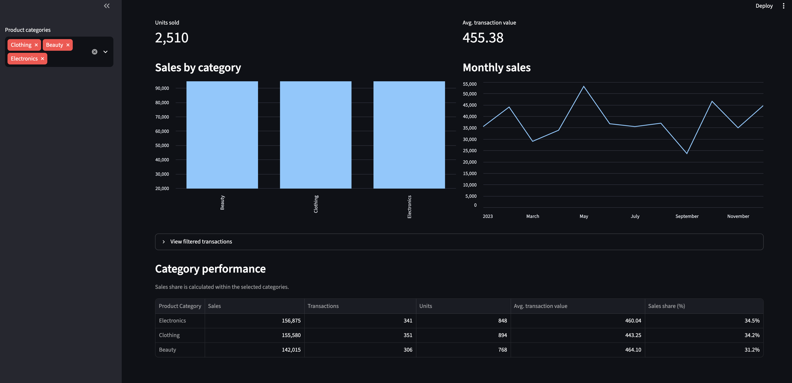

# Retail Sales Dashboard

An interactive dashboard exploring retail sales using Python, pandas,
SQL, and Streamlit.

## Dashboard Preview



## Features

- Filter by product category.
- View sales, transaction counts, units sold, and average transaction value.
- Explore monthly sales and category performance.
- Inspect filtered transactions.
- Validate SQL category sales against pandas calculations.

## Dataset

Source: [Kaggle Retail Sales Dataset](https://www.kaggle.com/datasets/mohammadtalib786/retail-sales-dataset)

The CSV contains 1,000 transactions spanning January 1, 2023 through
January 1, 2024.

The dashboard and SQL analysis use only 2023, covering 998 transactions.
The exploratory analysis script also reports full-dataset totals and
a category chart, while its monthly chart uses 2023 only.

## Key Findings — 2023

| Metric | Value |
|---|---:|
| Total sales | 454,470 |
| Transactions | 998 |
| Units sold | 2,510 |
| Average transaction value | 455.38 |

- Electronics generated the most revenue: 156,875.
- Clothing sold the most units: 894.
- Beauty had the highest average transaction value: 464.10.
- May recorded the highest monthly sales: 53,150.
- September recorded the lowest monthly sales: 23,620.

## Data Quality

Initial checks found no missing values or duplicate rows.
SQL and pandas category sales were compared programmatically and matched.

## Limitations

- Currency is not specified in the CSV.
- Costs are unavailable, so profit cannot be calculated.
- Each customer ID appears once, preventing repeat-purchase analysis.
- One year of monthly results does not establish recurring seasonality.
- Stock levels are unavailable, so inventory shortages cannot be assessed.
- These findings describe this dataset and should not be generalized
  to the wider retail market.

## Tools

Python, pandas, Matplotlib, SQLite, and Streamlit.

## Run Locally

Requires Python 3.11 or a compatible version.

From the project folder on macOS:

```bash
python3 -m venv .venv
source .venv/bin/activate
python -m pip install -r requirements.txt
```

Place `retail_sales_dataset.csv` in the project folder.

Start the dashboard:

```bash
python -m streamlit run app.py
```

Run the exploratory analysis:

```bash
python analysis.py
```

Close each chart window to let the script continue.

Run the SQL analysis and validation:

```bash
python sql_analysis.py
```

The SQL script creates a local `retail_sales.db` database.

## Project Files

- `app.py`: interactive dashboard
- `analysis.py`: exploratory analysis and saved charts
- `sql_analysis.py`: SQL queries and pandas comparison
- `requirements.txt`: required Python packages
- `.gitignore`: files excluded from Git
- `outputs/`: generated charts